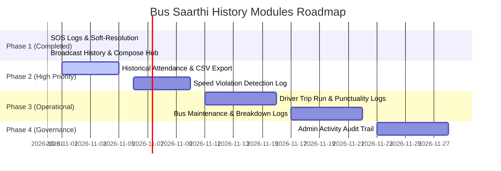

# Bus Saarthi — History, Audit & Fleet Intelligence Modules Proposal

**Document Version:** 1.0.0  
**Target Systems:** Web Admin Dashboard & Transport Incharge (TI) Panel  
**Project:** Invertis Bus Saarthi (Fleet & Passenger Management System)  
**Date:** October 2026  

---

## 1. Executive Summary

Bus Saarthi serves as the central transport and fleet operations hub for Invertis University, coordinating thousands of student and staff passenger daily commutes across dozens of bus routes. 

While the system handles live telemetry, bus merges, attendance capture, and emergency SOS alerts, modern institutional fleet operations require **comprehensive historical logs, accountability audit trails, and compliance reporting**.

This document outlines the architecture, database models, API designs, and UI specifications for the next generation of **History and Audit Modules** recommended for integration into the **Admin Dashboard** and **Transport Incharge (TI) Dashboard**.

---

## 2. Current State vs. Recommended Evolution

| Category | Current State | Proposed Enhancement |
| :--- | :--- | :--- |
| **Emergency SOS Alerts** | ✅ Live tracking, soft-resolution (`active`, `resolved`, `cancelled`), resolution notes, audit attribution | Enhanced with response time analytics & automated escalation SMS |
| **Broadcast Notices** | ✅ Full history feed, compose tool, instant push & socket broadcast, deletion | Targeted route broadcasts (e.g., broadcast only to Route 4 passengers) |
| **Attendance Logs** | ⚠️ Today's live logs only; no past date search or export | 🚀 **Historical Attendance Hub** with multi-date range, per-student monthly log, and CSV/Excel export |
| **Driver & Trip Operations** | ⚠️ Live GPS streaming only; no recorded trip run record | 🚀 **Daily Trip Run & Punctuality History** (trip start/end, actual vs. scheduled, delay minutes) |
| **Speed & Safety Violations** | ⚠️ Speed analytics graph exists, but no permanent violation table | 🚀 **Speed & Safety Violation Logs** (automated infraction log with driver, route, max speed, map pin) |
| **Fleet Maintenance** | ⚠️ Simple `active/maintenance/retired` enum only | 🚀 **Vehicle Maintenance & Workshop Service History** (breakdown logs, repair costs, insurance & fitness alerts) |
| **Administrative Actions** | ❌ No tracking of who changed route, bus, or fee status | 🚀 **Admin & Staff Audit Trail** (immutable changelog of user/route modifications) |

---

## 3. Detailed Module Specifications

---

### Module 1: Historical Attendance & Boarding Intelligence

#### 1.1 Objective & Rationale
Currently, the dashboard only reflects today’s live boarding records. University administrators and parents frequently require proof of boarding for past dates (e.g., *"Did student S001 board Bus 5 on October 14?"* or *"What was the average boarding percentage on Route 2 last month?"*).

#### 1.2 Key Features
1. **Date-Range Filtering:** Query attendance by Single Date, Custom Range, or Pre-set (This Week, This Month).
2. **Student Commute Audit:** Search by Student Name or Registration ID to view their full 30-day boarding history.
3. **Route & Bus Filter:** View attendance trends per route to identify under-utilized buses.
4. **Export Engine:** One-click **"Export to Excel / CSV"** for institutional reporting.

#### 1.3 Database Architecture (Prisma Schema)
The existing `Attendance` model is leveraged and enhanced with indexes:
```prisma
model Attendance {
  id              String     @id @default(dbgenerated("gen_random_uuid()")) @db.Uuid
  passengerId     String     @map("passenger_id") @db.VarChar(50)
  routeId         String     @map("route_id") @db.VarChar(20)
  name            String?    @db.VarChar(100)
  feeStatus       FeeStatus? @map("fee_status")
  confidence      Float?     @db.Real
  timestamp       DateTime   @default(now()) @db.Timestamptz(6)
  originalRouteId String?    @map("original_route_id") @db.VarChar(20)
  mergeEventId    String?    @map("merge_event_id") @db.Uuid
  deviceType      String?    @default("rfid") @db.VarChar(20) // rfid, face_recognition, manual_sync
  passenger       User       @relation(fields: [passengerId], references: [loginId], onDelete: Cascade)

  @@index([timestamp])
  @@index([passengerId, timestamp])
  @@index([routeId, timestamp])
  @@map("attendance")
}
```

#### 1.4 REST API Endpoints
- `GET /api/attendance/history`:
  - **Query Params:** `startDate`, `endDate`, `routeId`, `passengerId`, `page`, `limit`
  - **Returns:** Paginated attendance records + summary statistics (total boardings, unique passengers, fee paid vs. unpaid ratio).
- `GET /api/attendance/export`:
  - **Returns:** Streamed CSV file with formatted columns (`Date`, `Time`, `Student ID`, `Student Name`, `Route`, `Bus Number`, `Verification Method`).

---

### Module 2: Driver Run & Trip Punctuality Logs

#### 2.1 Objective & Rationale
Bus Saarthi tracks live bus coordinates, but there is no historical record answering: *"Did Driver Ramesh start Route 1 on time this morning? What time did Bus UP25 AB 1001 reach the university gate?"*

#### 2.2 Key Features
1. **Trip Lifecycle Logging:** Records `TRIP_STARTED`, `WAYPOINTS_CROSSED`, and `TRIP_COMPLETED`.
2. **Schedule vs. Actual Comparison:** Compares actual arrival time with scheduled university arrival (e.g. 8:45 AM).
3. **Delay Metrics:** Flags delayed trips automatically with amber/red tags (e.g., `+18 mins delay`).
4. **Driver Performance Card:** Shows on-time performance percentage (OTP) for every driver.

#### 2.3 Database Architecture (Prisma Schema)
```prisma
model TripLog {
  id              String      @id @default(dbgenerated("gen_random_uuid()")) @db.Uuid
  routeId         String      @map("route_id") @db.VarChar(50)
  busNumber       String      @map("bus_number") @db.VarChar(30)
  driverId        String      @map("driver_id") @db.VarChar(50)
  driverName      String?     @map("driver_name") @db.VarChar(100)
  tripType        String      @default("morning_pickup") @map("trip_type") // morning_pickup, evening_drop
  scheduledStart  DateTime    @map("scheduled_start") @db.Timestamptz(6)
  actualStart     DateTime?   @map("actual_start") @db.Timestamptz(6)
  actualEnd       DateTime?   @map("actual_end") @db.Timestamptz(6)
  delayMinutes    Int         @default(0) @map("delay_minutes")
  totalDistanceKm Float?      @map("total_distance_km")
  status          String      @default("completed") @db.VarChar(20) // in_transit, completed, cancelled, broken_down
  notes           String?
  createdAt       DateTime    @default(now()) @map("created_at") @db.Timestamptz(6)

  @@index([routeId, createdAt])
  @@index([driverId, createdAt])
  @@map("trip_logs")
}
```

#### 2.4 REST API Endpoints
- `GET /api/trips/history`: Filter by date, route, driver, trip type, or delayed trips.
- `GET /api/trips/analytics`: High-level monthly OTP (On-Time Performance) rate.

---

### Module 3: Speeding & Safety Infraction Logs

#### 3.1 Objective & Rationale
Student safety is paramount. Routes currently have a `speed_limit` (typically 60 km/h). When a driver exceeds this limit or drives erratically, an immutable violation record must be logged with GPS coordinates so the Transport Incharge can take disciplinary action.

#### 3.2 Key Features
1. **Automated Infraction Detection:** Telemetry service checks incoming speed against route `speed_limit` + 5 km/h buffer.
2. **Violation Dossier:** Captures Driver Name, Bus Number, Peak Speed, Location Coordinates, and Duration of speeding.
3. **Penalty & Warning Workflow:** Allows Transport Incharge to issue digital warnings or mark infractions as resolved after driver counselling.
4. **Map Preview:** Mini Leaflet map pin pointing the exact spot of the violation.

#### 3.3 Database Architecture (Prisma Schema)
```prisma
model SpeedViolation {
  id            String    @id @default(dbgenerated("gen_random_uuid()")) @db.Uuid
  routeId       String    @map("route_id") @db.VarChar(50)
  busNumber     String    @map("bus_number") @db.VarChar(30)
  driverId      String?   @map("driver_id") @db.VarChar(50)
  driverName    String?   @map("driver_name") @db.VarChar(100)
  recordedSpeed Float     @map("recorded_speed")
  speedLimit    Int       @map("speed_limit")
  latitude      Float     @map("latitude")
  longitude     Float     @map("longitude")
  locationName  String?   @map("location_name") @db.VarChar(200)
  severity      String    @default("moderate") @db.VarChar(20) // minor (1-5 over), moderate (6-15 over), critical (>15 over)
  status        String    @default("pending_review") @db.VarChar(20) // pending_review, warned, penalized, dismissed
  actionNotes   String?   @map("action_notes")
  reviewedBy    String?   @map("reviewed_by") @db.VarChar(50)
  reviewedAt    DateTime? @map("reviewed_at") @db.Timestamptz(6)
  timestamp     DateTime  @default(now()) @db.Timestamptz(6)

  @@index([routeId, timestamp])
  @@index([driverId, timestamp])
  @@index([severity])
  @@map("speed_violations")
}
```

---

### Module 4: Bus Maintenance & Fleet Workshop Logs

#### 4.1 Objective & Rationale
Currently, the `Bus` model only maintains an active/maintenance toggle. In a university fleet with 30+ vehicles, transport managers must track maintenance schedules, breakdown reasons, repair expenses, and regulatory expiry dates (Fitness Certificate, Pollution, Insurance).

#### 4.2 Key Features
1. **Breakdown & Repair History:** Logs why a bus was pulled from service (e.g. Engine Overheating, Brake Pad Replacement, Tyre Replacement).
2. **Cost Tracking:** Workshop bills, spare parts costs, and mechanics attributed to each vehicle.
3. **Statutory Expiry Alarms:** Automatic warnings 30 days and 7 days prior to Vehicle Insurance, Fitness Certificate, or Road Tax expiration.
4. **Downtime Calculation:** Tracks total days a bus was out of service to identify recurring lemons.

#### 4.3 Database Architecture (Prisma Schema)
```prisma
model BusMaintenanceRecord {
  id              String    @id @default(dbgenerated("gen_random_uuid()")) @db.Uuid
  busNumber       String    @map("bus_number") @db.VarChar(30)
  serviceType     String    @map("service_type") @db.VarChar(50) // periodic_service, breakdown_repair, tyre_replacement, inspection
  description     String
  workshopName    String?   @map("workshop_name") @db.VarChar(100)
  cost            Decimal?  @db.Decimal(10, 2)
  odometerKm      Int?      @map("odometer_km")
  startDate       DateTime  @map("start_date") @db.Date
  completionDate  DateTime? @map("completion_date") @db.Date
  status          String    @default("in_progress") @db.VarChar(20) // in_progress, completed, awaiting_parts
  partsReplaced   String?   @map("parts_replaced")
  servicedBy      String?   @map("serviced_by") @db.VarChar(100)
  loggedBy        String    @map("logged_by") @db.VarChar(50)
  createdAt       DateTime  @default(now()) @map("created_at") @db.Timestamptz(6)

  @@index([busNumber])
  @@map("bus_maintenance_records")
}
```

---

### Module 5: Administrative & Staff Activity Audit Trail

#### 5.1 Objective & Rationale
When multiple administrators and transport incharges manage routes, fees, and students, mistakes happen (e.g., student S045 was accidentally reassigned to Route 9, or a complaint was marked resolved by mistake). An audit trail provides zero-deniability accountability.

#### 5.2 Key Features
1. **Immutable Log:** Every write operation on users, routes, buses, and fee statuses creates an append-only audit row.
2. **Diff Inspection:** Stores the old value and the new value as structured JSON.
3. **Actor Attribution:** Records exactly who performed the action, their role, and their IP address.

#### 5.3 Database Architecture (Prisma Schema)
```prisma
model AuditLog {
  id         String   @id @default(dbgenerated("gen_random_uuid()")) @db.Uuid
  actorId    String   @map("actor_id") @db.VarChar(50)
  actorName  String   @map("actor_name") @db.VarChar(100)
  actorRole  String   @map("actor_role") @db.VarChar(30)
  action     String   @db.VarChar(50) // USER_UPDATE, ROUTE_MODIFY, FEE_STATUS_CHANGE, SOS_RESOLVE, BUS_MERGE
  targetType String   @map("target_type") @db.VarChar(50) // user, route, bus, grievance, attendance
  targetId   String   @map("target_id") @db.VarChar(50)
  details    Json?    // { "before": { ... }, "after": { ... } }
  ipAddress  String?  @map("ip_address") @db.VarChar(45)
  timestamp  DateTime @default(now()) @db.Timestamptz(6)

  @@index([actorId, timestamp])
  @@index([targetType, targetId])
  @@index([action])
  @@map("audit_logs")
}
```

---

## 4. UI/UX Dashboard Integration Plan

Rather than cluttering the top navigation with 8 different tabs, we recommend an **Enterprise Hub Layout**:

### Top Tabs (Admin & TI Panels):
1. **Fleet & Live Tracking** (Map + Live Telemetry)
2. **Merge & Cancel** (Route consolidation)
3. **Routes** (Route & Stops management)
4. **Users** (Students, Drivers, Parents, Staff)
5. **Complaints** (Student & staff grievances)
6. **Attendance** (Live daily check-in)
7. **Alerts & History Hub** *(Unified Centralized Records)*:
   - **Sub-Tab 1:** 🚨 Emergency SOS Logs
   - **Sub-Tab 2:** 📢 Broadcast Notices
   - **Sub-Tab 3:** 📅 Historical Attendance & CSV Export
   - **Sub-Tab 4:** ⏱️ Trip Punctuality & Driver Logs
   - **Sub-Tab 5:** ⚠️ Speed & Safety Violations
   - **Sub-Tab 6:** 🔧 Vehicle Maintenance & Workshop
   - **Sub-Tab 7:** 🛡️ Admin Audit Trail

---

## 5. Phased Implementation Roadmap



---

## 6. Summary of Action Items

1. **Review & Prioritize:** Confirm which Phase 2 module to implement first (recommended: **Historical Attendance with CSV Export**).
2. **Database Migrations:** Apply proposed tables via non-destructive SQL migrations.
3. **Controller & Service Layer:** Add NestJS controllers matching the REST specifications.
4. **UI Integration:** Extend the `AlertsAndHistory.jsx` component with the selected sub-tabs.
